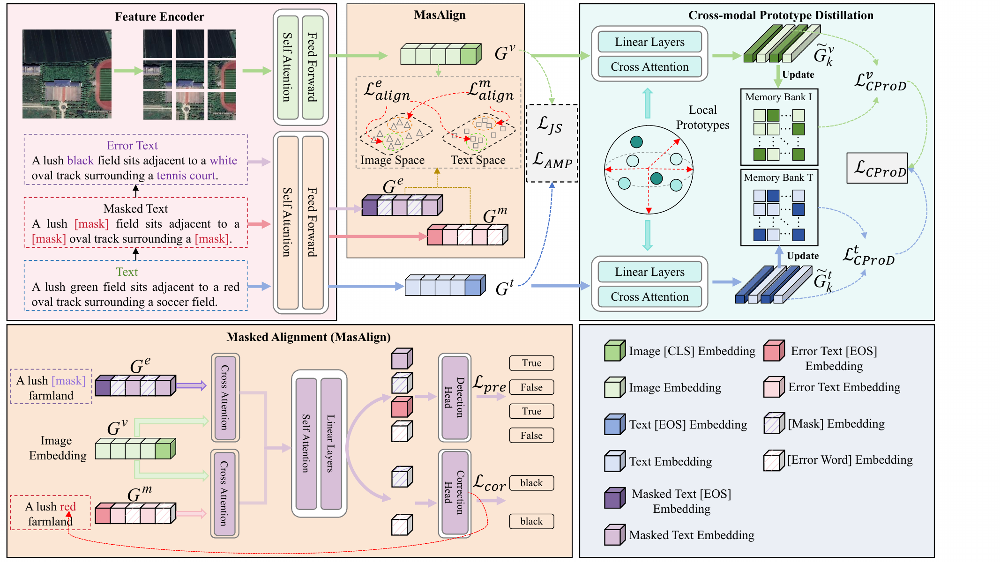

<div align="center">

# SAG-AlignNet

### Image–Text Retrieval for Agricultural Datasets

Semantic-aligned grounding · Cross-modal prototype distillation · Collaborative retrieval

<br>



<br>

*SAG-AlignNet model overview.*

</div>

---

## Datasets

| Dataset | Config | Checkpoint |
|:--|:--|:--|
| FRS-CMR | `configs/FRS-CMR.yaml` | `checkpoints/FRS-CMR.pth` |
| CroDis4CMR | `configs/CroDis4CMR.yaml` | `checkpoints/CroDis4CMR.pth` |
| CCPRD | `configs/CCPRD.yaml` | `checkpoints/CCPRD.pth` |
| GjPest4CMR | `configs/GjPest4CMR.yaml` | `checkpoints/GjPest4CMR.pth` |
| FruDis4CMR | `configs/FruDis4CMR.yaml` | `checkpoints/FruDis4CMR.pth` |

Dataset images and annotations are not included. Prepare the data locally. The standard output layout is:

```text
data/AgriSearch/<dataset>/{img,json/<dataset>.json}
```

Prepare annotations and check image paths:

```bash
python tools/prepare_agrisearch.py \
  --source-root /path/to/retrieval/data \
  --output-root data/AgriSearch \
  --check-images
```

The script preserves existing splits. To create new deterministic 80/10/10 splits, add `--generate-splits --seed 1`.

## Environment

Reference setup: Python 3.8, PyTorch 2.1.1, CUDA 12.1.

```bash
conda env create -f environment.yml
conda activate sag-alignnet
pip install -r requirements.txt
```

The first run downloads the CLIP ViT-B/16 initialization weights. For offline use, set `pretrain_choice` in the config to a local weight file.

## Train

Each config uses 30 epochs and seed 1. For example, train on CCPRD with one GPU:

```bash
python train.py --config-file configs/CCPRD.yaml
```

Use GPU 0 and GPU 1:

```bash
CUDA_VISIBLE_DEVICES=0,1 torchrun --standalone --nproc_per_node=2 \
  train.py --config-file configs/CCPRD.yaml
```

Replace `CCPRD.yaml` with another dataset config to change the dataset. The best validation checkpoint and training logs are written under `outputs/`.

## Evaluate

Evaluate a checkpoint and save bidirectional retrieval metrics:

```bash
python evaluate.py \
  --config-file configs/CCPRD.yaml \
  --checkpoint checkpoints/CCPRD.pth \
  --split val \
  --eval_output outputs/CCPRD_val.json
```

The output includes I2T and T2I R@1, R@5, R@10, mAP, and mINP, plus bidirectional mR. Use `--split test` for test-set evaluation.

## Checkpoints and code

Checkpoints are model-only files tracked with Git LFS. The released weights are historical runs whose checkpoint selection used the test split; use validation-based selection for new experiments. See [`checkpoints/README.md`](checkpoints/README.md) for details.

The core code is grouped under `src/`; configs and data-preparation tools are easy to find at the repository root.
